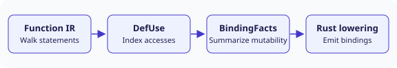

# Def-Use

Def-use records where each IR binding is initialized, read, written, or exposed
through its address. Slate builds a `DefUse` index in one walk of a function
body. Queries use the binding's ID, so two locals spelled `x` in different
scopes have separate entries.

## Why it matters

A definition gives a binding a value. A use reads that value or exposes its
storage. Both matter when moving code or choosing a Rust representation. For
example, `x = 2` requires a mutable binding after initialization, and
`prepare(&x)` can change `x` even when the IR shows no direct assignment. Moving
a temporary initializer past either use can change the value it reads.

The shared index gives transforms and lowering the same account of those
accesses. A transform checks where the accesses occur before moving code.
Analysis summarizes them into binding facts that lowering uses to decide whether
to emit `mut`.

<figure style="margin-inline: 0; text-align: center;">



</figure>

## Collect accesses

The walker numbers statements as it enters them, before visiting their children.
Every statement subtree occupies a contiguous range. Loop and switch bodies have
recorded ranges, so a consumer can check whether a binding is touched inside a
particular body.

| Access                   | What the walker records                                                                                                                        |
| ------------------------ | ---------------------------------------------------------------------------------------------------------------------------------------------- |
| `Initialize`             | The value supplied when a binding is declared.                                                                                                 |
| `Read`, `ReadProjection` | A read of the binding or of a projected part, such as an aligned field.                                                                        |
| `Write`                  | An assignment or update. An update such as `x += 1` records a read as well.                                                                    |
| `Argument`               | An address or fixed array passed directly as a call argument. Lowering resolves the kind of borrow from the selected parameter representation. |
| `Escape`                 | An opaque place or address use, such as storing the address, exposing it to assembly, or capturing it by reference.                            |
| `Capture`                | A use with no replaceable value expression, such as a VLA extent named by a type or a by-value block capture.                                  |

The walker stops at inner function bodies. At the literal or definition it
records uses of captured outer bindings. Each inner body gets its own walk.

## Read a chain

```c
int bump(int a) {
    int x = a;
    x += 1;
    return x;
}
```

```text
int x = a   → Read(a), Initialize(x)
x += 1      → Read(x), Write(x)
return x    → Read(x)
```

This sketch groups the accesses by source statement. In the straight-line
region, the initializer feeds the update's read, and the update feeds the
return's read. The write after initialization means the lowerer emits
`let mut x`.

Two branches that assign `x` produce two write entries. Their position numbers
describe where the writes appear in the IR. Which write reaches a later read
depends on the branch taken. Consumers that need execution order check a
straight-line region for labels, cases, and jumps before relying on positions.
For example, a backward jump can make a later write feed an earlier read.

## Use the facts

- **Mutability.** Analysis records writes after initialization, opaque place
  uses, and direct address or array arguments in `BindingFacts::mutability`.
  Lowering uses those facts and the chosen callee signature to decide whether
  the Rust binding needs `mut`. See [remove_mut](../lowering/remove_mut.md).
- **Declaration initialization.** Before moving a declaration to its first
  assignment, the transform checks that the intervening region leaves the
  binding untouched. An earlier call to `prepare(&x)` needs the storage in its
  original scope. See [Decl Init](../transforms/decl-init.md).
- **Temporary uses.** A single-read query requires one replaceable value read. A
  use in a VLA extent or capture keeps the temporary alive even when the
  ordinary expression walk sees only one read.

## Start in the code

- `DefUse::of` builds the per-function index. `single_read` checks for a
  replaceable read, and `touched_in` checks whether a binding appears in a
  statement range. `DefUse::for_mutability` builds the index used for binding
  mutability. These live in `crates/slate-analysis/src/def_use.rs`.
- `analyze` combines the results into `Facts`. `UnitFacts::binding` looks up a
  `BindingFacts` entry by `BindingId` within one translation unit. See
  `crates/slate-analysis/src/facts.rs`.
- `crates/slate/src/frontend/lowerer/` consumes `BindingFacts::mutability` when
  emitting bindings. A direct address argument stays distinct until lowering
  knows whether the call takes a shared or exclusive borrow.
