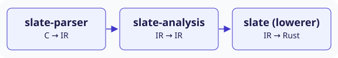

# Architecture

## Translation pipeline

<figure style="margin-inline: 0; text-align: center;">

</figure>

### `slate-parser`

`slate-parser` owns the meaning of the C source and produces IR.

1. **Preprocess.** Resolve includes and conditional branches, and expand macros.
2. **Tokenize.** Convert the preprocessed input into C tokens.
3. **Parse.** Build a syntax tree from the tokens.
4. **Check semantics.** Resolve names and types, check constraints, and
   determine conversions and target layout.
5. **Emit IR.** Record the checked program in IR, making operations such
   as conversions and evaluation order explicit for the next stage.

### `slate-analysis`

`slate-analysis` is the middle end. It takes IR and does two things.

- **Transform the IR.** Rewrite C operations into simpler forms while preserving
  their meaning.
- **Compute facts.** Analyze the translation units for one target together.
  Record facts alongside the IR, such as what a pointer may reference or how
  many elements it can access.

### `slate`

Slate's lowerer turns the IR into a Rust syntax tree and uses the analysis
facts to choose Rust representations. Slate then rewrites and emits the Rust. It
also owns Cargo crate generation and merging translations for multiple targets.

## Supporting crates

- **`slate-sysroots`** installs target and compiler headers. It owns how those
  headers and SDKs are discovered and installed.
- **`slate-intrinsic-gen`** generates the checked-in catalog that maps C builtin
  aliases to LLVM intrinsics. It owns catalog generation from upstream LLVM and
  Rust sources.
- **`slate-libc-gen`** generates target-specific mappings from C system
  declarations to Rust bindings. It owns the checks for compatible signatures,
  layouts, and values.
- **`slate-cargo-toml`** owns the typed models for the `Cargo.toml` and
  `.cargo/config.toml` files Slate writes.
- **`slate-mutate`** owns the IR mutations used by differential tests.
- **`slate-lints`** owns Slate-specific Rust lints, such as checks that pattern
  matches handle sensitive IR variants explicitly.
