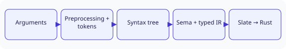

# Parsing

The parser turns one configured C translation unit into IR. It expands
preprocessor directives, tokenizes the resulting source, builds a syntax tree,
checks C semantics, and lowers checked syntax directly into IR.

<figure style="margin-inline: 0; text-align: center;">



</figure>

Each command handles one configuration: compiler flavor, language standard,
target, and options. Conditional branches are resolved before parsing. The
parser does not produce conditional AST nodes.

## Inspect parser output

Use `emit-slate-ir` to print the parser's IR:

```bash
cargo run --release -p slate-c2rust -- emit-slate-ir \
  --target=x86_64-unknown-linux-gnu -std=c11 -Iinclude -DTRACE=1 input.c
```

Common arguments select the target (`--target`), C dialect (`-std`), include
directories (`-I`), and preprocessor definitions (`-D`). Use `-U` to remove a
definition and `-include file` to process a file before the main source. Header
files come from configured include paths and `slate-sysroots`.

The command prints a debugging representation. Slate consumes the IR module
directly. The
[IR specification](https://github.com/takashiidobe/slate/blob/main/wiki/concepts/ir-spec.md)
defines that boundary.

## Stages

- [Translation Unit Configuration](configuration.md) explains the compiler
  settings shared by the frontend stages.
- [Preprocessing](preprocessing.md) expands directives, includes, and macros.
- [Tokenization](tokenization.md) turns source text into tokens and preserves
  source locations.
- [Parsing C syntax](syntax.md) builds a syntax tree without resolving C types.
- [Semantic analysis](sema.md) resolves names, types, conversions, and
  constraints.
- [IR](ir.md) describes the checked program for Slate.

The
[parser architecture concept](https://github.com/takashiidobe/slate/blob/main/wiki/concepts/parser-architecture.md)
records the design rules. These pages explain the working model and point to the
detailed specifications.
