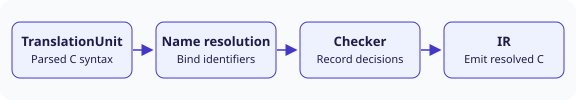

# Semantic Analysis

Sema resolves the meaning of C syntax for the selected compiler and target. It
checks the translation unit and records decisions such as operand conversions,
record layout, and call ABI. IR lowering uses those decisions to emit typed
operations that Rust lowering can translate directly.

<figure style="margin-inline: 0; text-align: center;">

</figure>

`Sema::new` resolves names and sets up the type resolver. `Sema::analyze` checks
the AST and records semantic decisions. `Sema::lower` consumes those records to
build [IR](ir.md).

## Semantic decisions

The examples use
`slate emit-slate-ir --target=x86_64-unknown-linux-gnu input.c`. IR excerpts
omit the surrounding module and target declarations.

- [Name Resolution](sema/names.md). Give each use a binding that survives into
  IR.
- [C Types, Layout, and ABI](sema/types-layout-abi.md). Resolve C type identity
  and how values are stored and passed.
- [Expressions and Conversions](sema/expressions.md). Record the C computation
  type and each operand conversion.
- [Constant Evaluation](sema/constants.md). Resolve values that C requires
  before Rust code can be emitted.
- [Initializers](sema/initializers.md). Turn C initializer syntax into explicit
  subobject choices.
- [Builtins and Inline Assembly](sema/builtins-asm.md). Resolve compiler
  operations into forms the Rust backend can handle.
- [Diagnostics and the Checker Contract](sema/checker-contract.md). Keep
  diagnostics and IR emission aligned.
