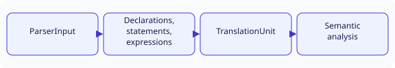

# Parsing C Syntax

The parser turns expanded tokens into a `TranslationUnit`. It groups the tokens
into declarations, statements, and expressions. It tracks typedef names where
they affect the grammar, as in `T *x;`. Sema resolves bindings and types after
parsing.

<figure style="margin-inline: 0; text-align: center;">

</figure>

## What Slate's AST carries forward

Slate needs enough source context to write a new source file. The AST carries
comments, macro records, source locations, and annotations alongside the C
syntax so later stages can use them when emitting Rust.

- **Comments.** The parser groups comments and marks them as leading, trailing,
  or detached. A comment on the line above a declaration can follow that
  declaration into Rust. A detached file comment keeps an anchor in source
  order. Sema resolves comment ownership and carries it into IR.
- **Macros.** The tree represents the expanded program. `TranslationUnit` also
  carries the invocation table, and node spans mark which parts came from the
  macro body or an argument. Sema can use those boundaries to mark recoverable
  macro regions in IR. See [Macro Provenance](macro-provenance.md).
- **Source locations.** A node span keeps where its tokens were spelled and
  where they expanded. An operator written in a macro can point to the
  definition while its expansion points to the invocation. Distinct nodes can
  share that location, so Slate also gives each node its own ID.
- **Attributes and pragmas.** The parser records their placement and parsed
  arguments. Sema decides their effect. For example, a pack pragma stays in
  source order so it can affect the layout of the record that follows. Rust
  lowering then uses that resolved layout.

## Source forms that help recover Rust

The AST starts with the form the author wrote. Sema can preserve the parts that
still help after types and conversions are resolved.

- **Control flow.** A C `for` keeps its initializer, test, increment, and body
  through typed IR. Keeping those parts together lets
  [counted loop analysis](../analysis/counted-loops.md) recognize an index range
  that lowering can emit as a Rust `for`. The IR also keeps explicit blocks and
  the targets of `break` and `continue` so lowering can preserve scopes and
  exits.
- **Explicit casts.** The AST records the written cast. Sema distinguishes it
  from a conversion introduced by C's type rules. For example, in
  `unsigned n = (unsigned)flag;`, the cast came from the source. A transform can
  fold eligible implicit conversions while keeping the explicit cast available
  to lowering. See [Const Fold](../transforms/const-fold.md).
- **Initializer shape.** The AST keeps the braces and designators in
  `struct point p = { .y = 3, .x = 1 };`. Sema uses them to resolve which
  subobjects are initialized and what conversions they need. Rust lowering
  receives the resolved initialization, including the field choices.

Some source forms have served their purpose by the time sema emits IR. For
example, the AST keeps parentheses while parsing an expression. The nested
operations already express their grouping in typed IR, so the inner operation
can carry its own span without a separate parenthesis node.

## Hand the tree to sema

Before resolving names, Slate prunes header declarations that the translation
unit does not need. Declarations in the main file and forced includes are
roots. So are declarations that need to be emitted, such as functions defined
with external linkage. Slate keeps the declarations those roots depend on.

This avoids resolving and translating unused SDK declarations. Use the parser's
`--all-declarations` mode when inspecting declarations that normal translation
would prune. The remaining tree goes to [Semantic Analysis](sema.md).
