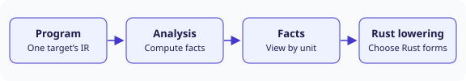

# Analyses

`slate-analysis` computes facts from IR for one target at a time. A
`Program` contains that target's translation units after IR transforms. Analysis
reads the program and produces read-only `Facts`. Lowering uses those facts to
choose Rust representations, such as a slice for a pointer with a proven extent.

<figure style="margin-inline: 0; text-align: center;">

</figure>

## Analysis stages

`analyze` in `crates/slate-analysis/src/facts.rs` coordinates the stages.
Function identity and loop facts feed pointer analysis. Pointer analysis uses
call effects and supplies results to the analyses of local values.

- [Function Identity](analysis/function-identity.md). Recognize library calls
  from their declarations.
- [Counted Loops](analysis/counted-loops.md). Prove the iteration range of a C
  loop.
- [Pointers and Lengths](analysis/pointers.md). Track pointer use and extent
  across calls.
- [Call Effects](analysis/effects.md). Track which mutable static objects a call
  can reach.
- [String and Buffer Views](analysis/string-buffer-views.md). Recognize local
  values that can be borrowed as strings or bytes.
- [Heap Allocations](analysis/heap-allocations.md). Prove buffer ownership and
  track allocation uses.
- [Printf Formats](analysis/printf-formats.md). Recognize literal formats and
  matching arguments.
- [Def-Use](analysis/def-use.md). Index binding accesses and summarize
  mutability.
- [Facts and Lowering](analysis/facts.md). Look up results for a translation
  unit.
